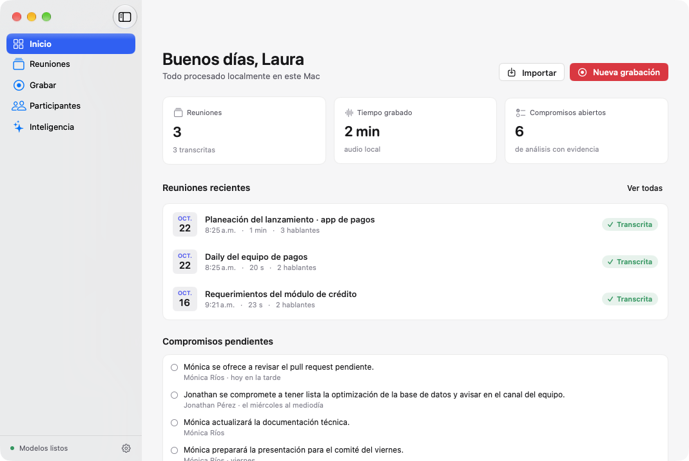
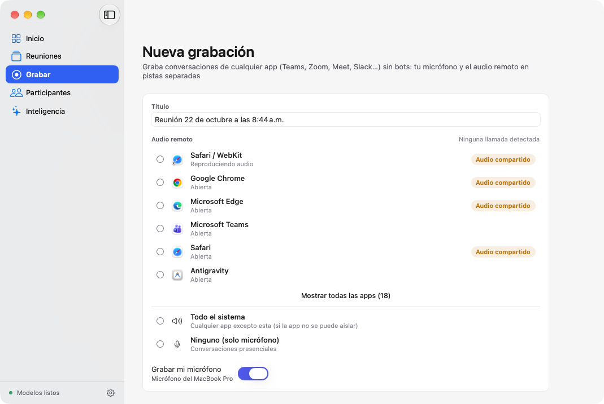
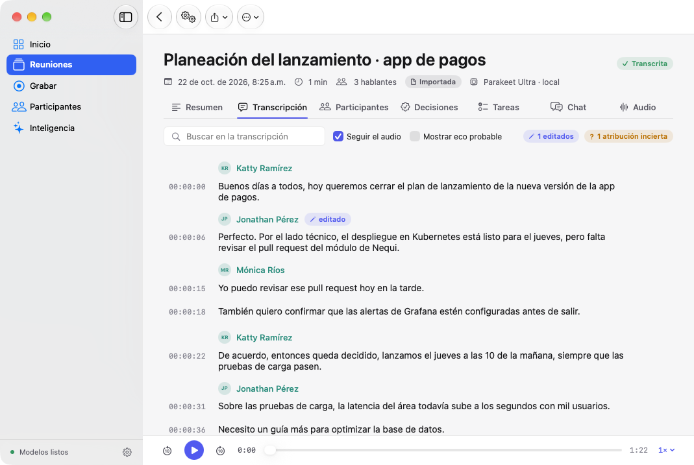
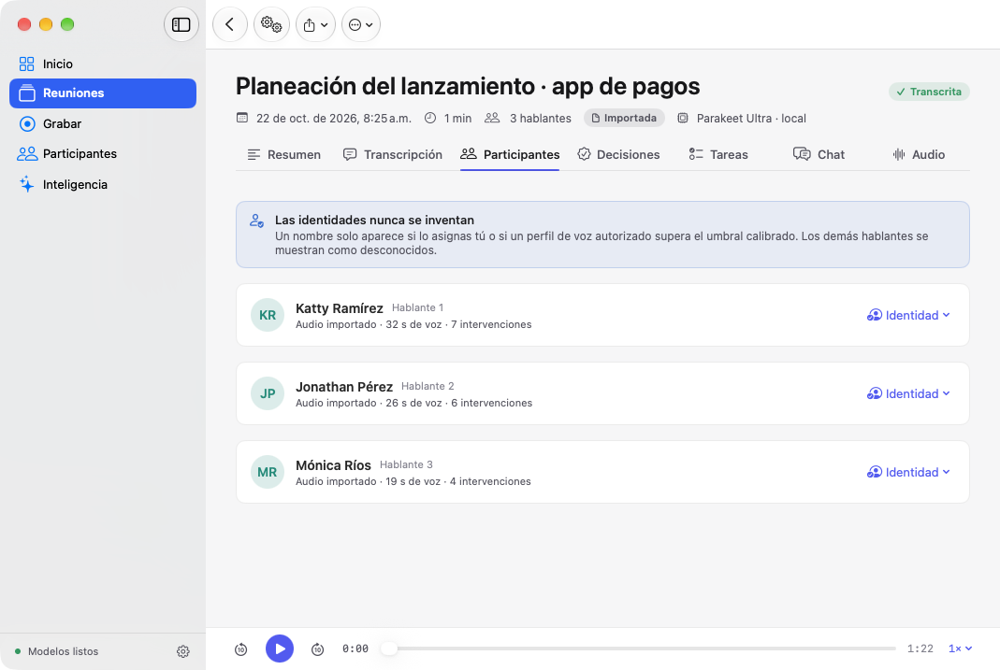
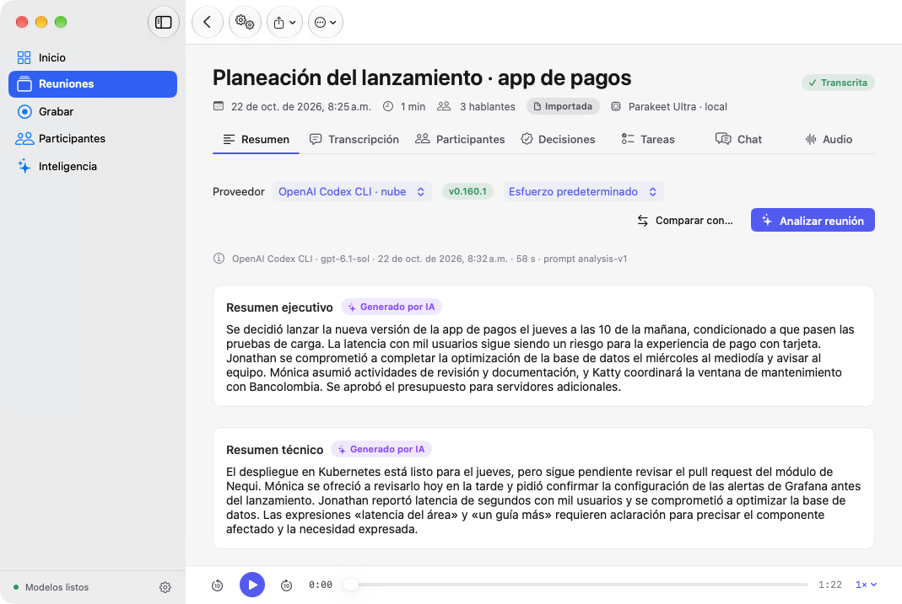
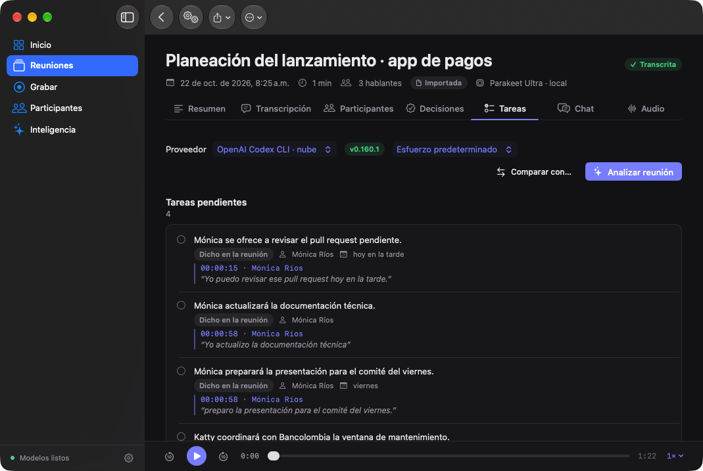
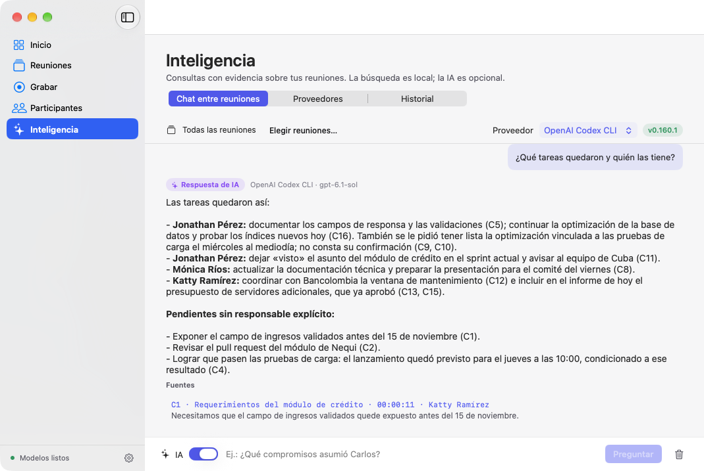
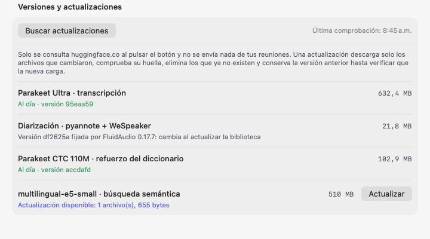
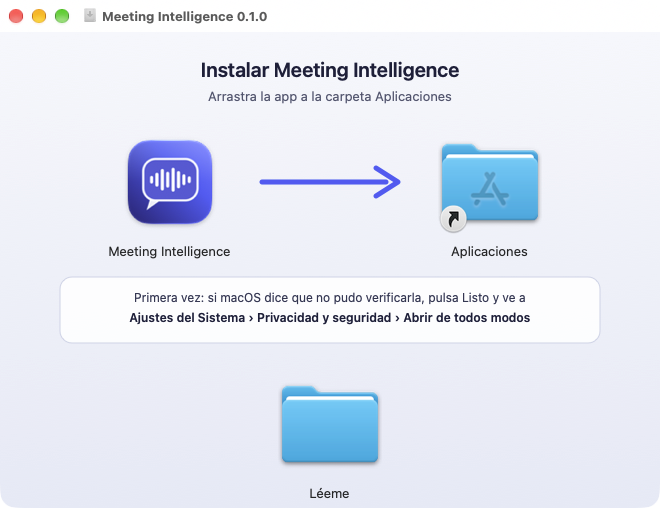

# Meeting Intelligence

Aplicación **nativa de macOS** (Swift 6 + SwiftUI) para grabar, transcribir, identificar participantes y analizar
conversaciones de **cualquier app de videollamada** (Teams, Zoom, Meet, Slack, Webex…) — sin bots, sin modificar las
apps y **local por defecto**.

- Captura el **micrófono** y el **audio de la app elegida** en pistas separadas y sincronizadas (Core Audio Process Taps).
- **Detecta llamadas** de cualquier app (micrófono + audio a la vez) y **sugiere** grabar y detener; nunca lo hace sola.
- **Video opcional de una ventana**, con selector nativo de macOS y audio sincronizado; exportación M4A/WAV/MP4 (TD-34; validación de larga duración pendiente).
- Transcribe localmente con **Parakeet Ultra** (FluidAudio + Core ML, Apple Neural Engine).
- Separa hablantes con **diarización offline** (pyannote community + WeSpeaker + VBx) y reconoce participantes
  registrados **solo con consentimiento** y umbrales **calibrados con tus propios datos**.
- Analiza reuniones con **Claude Code CLI, Codex CLI, Antigravity CLI, GitHub Copilot CLI u Ollama** — opcional, con confirmación explícita
  y **evidencia verificable** (cita exacta + timestamp) para cada hallazgo.
- Búsqueda local **SQLite FTS5** (y por significado, opcional), chat entre reuniones con citas e historial,
  exportación TXT/Markdown/JSON/SRT/PDF y un **servidor MCP** de solo lectura para clientes como Claude Code y Codex.
- **Actualiza los modelos** desde la app (solo descarga lo que cambió y verifica antes de reemplazar) y borra todo lo
  asociado a una reunión al eliminarla, devolviendo el espacio al disco.
- **Se actualiza a sí misma**: avisa cuando hay una versión nueva en GitHub y, si lo confirmas, la descarga, verifica
  su firma y se reinicia con ella.

## Capturas

> Datos de demostración **sintéticos**: voces del sistema (`say`) y personas ficticias. El análisis y la respuesta del
> chat son reales (Codex CLI sobre esa reunión de demostración); la transcripción y la diarización son las de la app.

| | |
|---|---|
|  **Inicio**: reuniones recientes y compromisos con evidencia. |  **Grabar**: cualquier app de llamada + tu micrófono, en pistas separadas. |
|  **Transcripción** local con hablantes, ediciones y marcas de revisión. |  **Participantes**: nombres solo si los asignas o por un perfil de voz calibrado. |
|  **Resumen** generado por IA, con proveedor, modelo y versión del prompt. |  **Tareas** con la cita exacta y el momento de la reunión (modo oscuro). |
|  **Chat entre reuniones**: búsqueda local y respuesta con fuentes verificables. |  **Modelos**: versión, tamaño y actualización verificada. |

## Descargar e instalar

1. Descarga `Meeting-Intelligence-<versión>.dmg` desde [Releases](https://github.com/corpjorge/MeetingIntelligence/releases)
   (o el `.zip`; las sumas SHA-256 están en `SHA256SUMS.txt`).
2. Abre el DMG y arrastra **Meeting Intelligence** a la carpeta **Aplicaciones** de la misma ventana:

   

3. Abre la app desde Aplicaciones. Como **no está notarizada por Apple**, macOS mostrará «No se abrió “Meeting
   Intelligence”»: pulsa **Listo**. Luego abre **Ajustes del Sistema › Privacidad y seguridad**, baja hasta
   **Seguridad** y pulsa **Abrir de todos modos** junto a «Se bloqueó “Meeting Intelligence”»; confirma con tu
   contraseña y pulsa **Abrir**. Solo hace falta la primera vez. (Desde macOS 15 ya no basta con clic derecho › Abrir.)
4. En el primer uso descarga los modelos locales (Parakeet Ultra ~630 MB y diarización ~22 MB) y pide permiso de
   **micrófono** y de **audio del sistema** cuando grabas por primera vez.

**Actualizar:** desde la 0.2.0, la app avisa cuando hay una versión nueva. Pulsa **Actualizar** y luego **Reiniciar e
instalar**. La descarga se verifica con la firma de la publicación antes de reemplazar nada, y nunca se instala
mientras grabas o procesas. Puedes desactivar la búsqueda automática en **Ajustes › General**, y también buscar desde
el menú **Meeting Intelligence › Buscar actualizaciones…**. La 0.1.0 no tiene actualizador: instala la 0.2.0 desde el
DMG y reemplaza la anterior. Como la app no tiene firma de desarrollador, macOS puede volver a pedir los permisos de
micrófono y de audio del sistema después de cada actualización.

**Requisitos:** Mac con Apple Silicon (M1 o posterior) y macOS 15 (Sequoia) o posterior. Los análisis con IA son opcionales y
usan las CLIs que tengas instaladas (Claude Code, Codex, Antigravity, GitHub Copilot) u Ollama.

**Desinstalar:** borra la app y, si quieres eliminar también tus datos, la carpeta
`~/Library/Application Support/MeetingIntelligence` (reuniones) y los modelos en
`~/Library/Application Support/FluidAudio/Models`.

Uso gratuito según [LICENSE](LICENSE); componentes de terceros en [THIRD_PARTY_NOTICES.md](THIRD_PARTY_NOTICES.md).

> El nombre es provisional: cámbialo en `config/app.env` (`APP_NAME`); no requiere tocar código Swift.

## Estado real (verificado el 29-oct-2026 en MacBook Pro M5 Pro, macOS 27.0.1)

| Área | Estado | Verificación |
|---|---|---|
| App macOS (SwiftUI, Design System, claro/oscuro) | ✅ Implementada | Compila; capturas de las 12 pantallas en ambos modos (modo instantánea); pruebas de la lógica de la app (preferencias, consentimiento de IA, cola de procesamiento, sugerencias de llamada) |
| Importar WAV/M4A/MP3/MP4 | ✅ | Pruebas + CLI |
| Transcripción Parakeet Ultra (local, ANE) | ✅ | Integración real: WER 0–9 % en fixtures sintéticos, RTFx 100–475× |
| Transcripción provisional en vivo (ventanas deslizantes Ultra) | ✅ | Prueba de integración real |
| Diarización offline + alineación palabra→hablante | ✅ | DER 6,2 % en fixture de 2 voces; 2/2 hablantes en reunión de 17,5 min |
| Reconocimiento persistente de participantes (cifrado, calibrado) | ✅ Implementado | Pruebas unitarias con embeddings sintéticos; **pendiente** validar con voces reales autorizadas |
| Captura de cualquier app (process tap por app) + micrófono, pausa, recuperación | ✅ Implementado | Pruebas de WAV, alineación, remuestreo y agrupación de procesos reales (Teams, Zoom, Chrome, Edge, Safari); **pendiente** prueba con llamada real (requiere tus permisos de macOS) |
| Detección de llamadas y sugerencias de inicio/fin | ✅ Implementado | Máquina de estados probada (inicio, prueba breve, cambio a AirPods, fin, cierre de app); lectura en vivo del HAL verificada con `afplay`; **pendiente** validar con llamada real |
| Pausar mi micrófono (sin perder sincronía) | ✅ | Prueba: silencio escrito, línea de tiempo intacta, pausa registrada |
| Reducción de eco de altavoces en el audio grabado (TD-33) | ✅ Implementado; validación real pendiente | AEC local con referencia remota por defecto; Apple opcional y desactivado; pruebas sintéticas de eco y doble habla, WAV y transcripción provisional; **pendiente** nueva llamada de Teams |
| Aviso "silenciado en la llamada ≠ pausado aquí" | ⚠️ Recordatorio estático | El silencio de Teams no es legible con APIs públicas (sonda en llamada real, TD-23); la API de terceros de Teams está bloqueada por la organización en la cuenta de prueba; no aplica a Zoom/Meet; **pendiente** verlo en una grabación real |
| Esfuerzo de IA por proveedor | ✅ | Flags verificados (`--effort` Claude/agy, `model_reasoning_effort` Codex, `think` Ollama por modelo) y probados |
| Edición de transcripción con historial | ✅ | Pruebas de persistencia |
| Marca de fragmentos de baja confianza del ASR (< 0,7, "revisar") | ✅ | Prueba de la regla; capturas claro/oscuro con una reunión real autorizada (solo verificación local); detecta solo ~40 % de los errores (TD-22) |
| Identidades manuales conservadas al reprocesar | ✅ | Integración real: asignar → reprocesar → identidad conservada |
| Correcciones de texto conservadas al reprocesar | ✅ | Pruebas: se trasladan solo las inequívocas (mismo texto ASR, inicio a ≤ 0,5 s, 1:1) y se avisa de las demás (TD-16) |
| Diccionario personalizado | ✅ | Pruebas + integración |
| Análisis IA con evidencia (Codex) | ✅ | Ejecución real con Codex CLI sobre reunión fixture |
| Análisis IA y chat con GitHub Copilot CLI | ✅ | Ejecución real sobre reunión fixture; sin herramientas comprobado con una sonda; `COPILOT_HOME` aislado (TD-12) |
| Análisis IA (Claude Code CLI / Antigravity / Ollama) | ✅ Implementado | Formatos de salida verificados; Claude: sesión OAuth expirada en el entorno de pruebas; Ollama no instalado |
| Chat entre reuniones (FTS5 + IA opcional) | ✅ | Pruebas |
| Historial persistente del chat (por reunión y entre reuniones) | ✅ | Pruebas de persistencia y de borrado de reuniones citadas; carga verificada en capturas |
| Búsqueda semántica local opcional (multilingual-e5-small) | ✅ Implementada | Prueba con el modelo real; de punta a punta 13/16 preguntas frente a 5/16 con FTS5 en fixtures sintéticos (TD-25); **pendiente** validar con reuniones reales |
| Refuerzo acústico del diccionario opcional (Parakeet CTC 110M) | ✅ Implementado | Pipeline real con voces sintéticas: 39/48 términos frente a 20/48, 0 palabras comunes dañadas; con un diccionario pequeño ya no reemplaza frases comunes (TD-24); **pendiente** con voces reales |
| Actualización de modelos desde la app (Hugging Face, verificada, con vuelta atrás) | ✅ | Prueba real sobre una copia de CTC 110M y de e5-small (detecta, descarga solo lo cambiado, elimina obsoletos, carga); estado de los modelos reales verificado (TD-27) |
| Borrar una reunión libera todo su espacio | ✅ | Pruebas: audio, filas, historial, vectores, muestras de voz opcionales, compactación de SQLite, restos huérfanos (TD-28) |
| Frases cortas aisladas redecodificadas con contexto | ✅ | Pistas sintéticas: 74/80 frente a 67/76; también corrige frases pegadas por la compactación (TD-26) |
| Servidor MCP (stdio, 2026-07-28 + 2025-11-25) | ✅ | Prueba stdio con el binario empaquetado |
| Actualizaciones de la app (GitHub, firma Ed25519, reinicio) | ✅ | Pruebas + de punta a punta con la app real: 0.2.0 → 0.2.1 con servidor local; firma alterada rechazada; primera actualización real en `/Applications`: reemplazo correcto, el reinicio fallaba con la hoja abierta (corregido en 0.2.2, TD-29) |
| Exportación TXT/MD/JSON/SRT/PDF | ✅ | Pruebas |
| Video de ventana, vista previa y exportación M4A/WAV/MP4 | ✅ Primera versión | Archivos reales y ventana sintética cubierta; pendiente llamada completa y medición de larga duración (TD-34/TD-36) |
| Micrófono por dispositivo e inicio cancelable | ✅ | Prueba física integrada de 3 s y pruebas de cancelación; sin cambiar la salida de Teams (TD-38) |
| Selección del proveedor/modelo en chat y ortografía nativa | ✅ | Pruebas de selección, envío y editor nativo; Enter/Mayús+Enter |

331 pruebas automatizadas pasan (`scripts/test.sh`, 30-oct-2026; otras 8 quedan omitidas bajo demanda). Las integraciones y mediciones adicionales de catálogos,
vocabulario, contexto, e5-small y actualización desde Hugging Face se activan bajo demanda; ver `TESTING.md`.

## Requisitos

- Mac con Apple Silicon, **macOS 15 (Sequoia) o posterior** (desarrollado en macOS 27.0.1; no probado en un Mac con macOS 15).
- **Command Line Tools** (Swift 6.4) — Xcode no es obligatorio. Con solo CLT se compila contra el SDK macOS 26.5
  incluido (ver `TECHNICAL_DECISIONS.md` › TD-02).
- ~1 GB libre para modelos (Parakeet Ultra ≈ 630 MB + diarización), descargados una vez desde Hugging Face.
- `ffmpeg` solo para regenerar los fixtures de prueba.

## Compilar y ejecutar

```bash
scripts/build-app.sh            # compila en release y crea "build/Meeting Intelligence.app"
open "build/Meeting Intelligence.app"
```

```bash
scripts/test.sh                 # suite completa (Swift Testing)
scripts/generate-fixtures.sh    # regenera los audios sintéticos de prueba (voces del sistema)
```

Primera ejecución: la bienvenida pide tu nombre y descarga los modelos. macOS pedirá **Micrófono** y
**Grabación de audio del sistema** al iniciar la primera grabación.

Publicar una versión (TD-29): sube `VERSION` en `config/app.env` y ejecuta:

```bash
scripts/package-release.sh                               # DMG, ZIP, firma de actualización (.zip.sig) y sumas en dist/
scripts/publish-release.sh docs/releases/<versión>.md    # tag + release en GitHub (añade --prerelease si aplica)
```

La firma de actualización usa una clave Ed25519 guardada en tu Llavero (`mi-release keygen`, una sola vez). Guarda una
copia: sin ella, las versiones futuras no se podrán instalar desde la app.
El empaquetador usa Python 3.10 o posterior y prepara herramientas fijadas en `build/dmg-tools` para escribir el
layout del DMG sin automatizar Finder. Esas dependencias no se incluyen en la app.

> Firma: por defecto el bundle se firma *ad hoc*, así que macOS vuelve a pedir permisos tras cada recompilación.
> Para conservarlos, usa una identidad de firma propia: `SIGN_IDENTITY="Mi certificado" scripts/build-app.sh`.

## CLI `mi`

Incluida en `build/Meeting Intelligence.app/Contents/MacOS/mi` (usa la misma biblioteca; otra con `MEETING_INTELLIGENCE_HOME`).

```bash
mi doctor                                   # entorno: modelos, dispositivos, procesos de Teams, permisos
mi import grabacion.m4a --title "Comité"    # importa + Ultra + diarización + reconocimiento
mi show <meetingId>                         # transcripción con hablantes y timestamps
mi search "indicador de ingresos"           # búsqueda local FTS5
mi export <meetingId> --format pdf
mi ai-providers                             # detecta Claude / Codex / Antigravity / Copilot / Ollama
mi analyze <meetingId> --provider codex --effort high --share
mi ask "¿Qué compromisos asumió Carlos?" --provider ollama
mi evaluate audio.wav --reference ref.txt --rttm ref.rttm   # WER / DER / RTFx reproducibles
```

## MCP

Activa el acceso en **Ajustes › MCP** (deshabilitado por defecto) y registra el servidor:

```bash
claude mcp add --scope user meeting-intelligence -- "/Applications/Meeting Intelligence.app/Contents/MacOS/meeting-intelligence-mcp"
```

```bash
codex mcp add meeting-intelligence -- "/Applications/Meeting Intelligence.app/Contents/MacOS/meeting-intelligence-mcp"
```

Herramientas de solo lectura: `list_meetings`, `get_meeting`, `get_transcript`, `get_participants`,
`search_meetings`, `get_decisions`, `get_action_items`, `compare_meetings`. Nunca expone audio ni datos biométricos.

## Documentación

- [ARCHITECTURE.md](ARCHITECTURE.md) — módulos, flujos, concurrencia, esquema.
- [TECHNICAL_DECISIONS.md](TECHNICAL_DECISIONS.md) — decisiones y limitaciones comprobadas.
- [TESTING.md](TESTING.md) — pruebas, fixtures y métricas medidas.
- [PRIVACY.md](PRIVACY.md) — datos, consentimiento, cifrado, qué sale del Mac.
- [ROADMAP.md](ROADMAP.md) — fases y pendientes.
- [CLAUDE.md](CLAUDE.md) — reglas para continuar el desarrollo con Claude Code.
